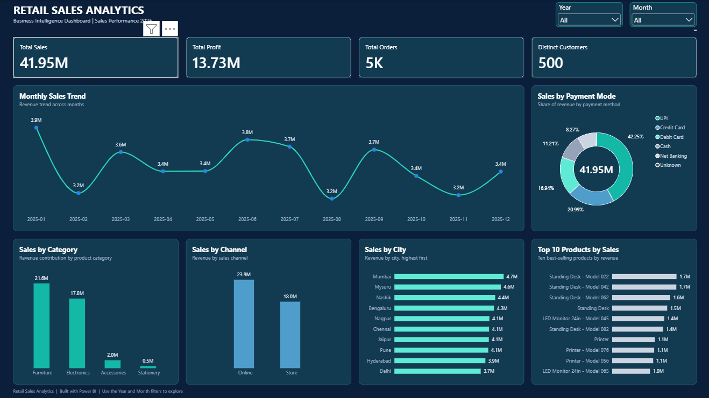
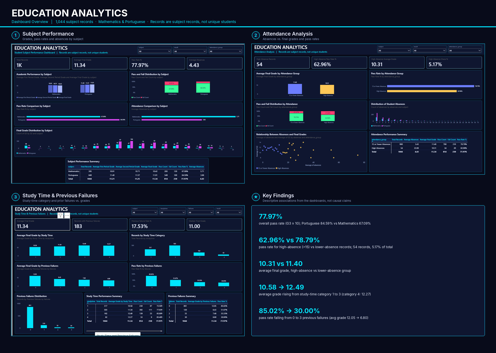
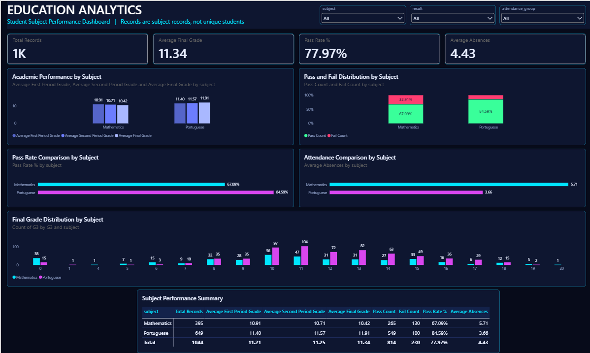

# Aaditya Mahajan | Data Analyst Portfolio

Welcome to my Data Analyst Portfolio! I use **Python, SQL, MySQL, Power BI and DAX** to explore datasets, solve business problems, build interactive dashboards and communicate data-driven insights.

This portfolio currently contains **3 completed projects** and **2 planned projects**.

---

## Portfolio Progress

| Project | Title | Status |
|---|---|---|
| 01 | Retail Sales Analytics | ✅ Completed |
| 02 | Education Analytics | ✅ Completed |
| 03 | Education 360° Business Analytics | ✅ Completed |
| 04 | HR Analytics & Workforce Intelligence | 🔜 Planned |
| 05 | Customer Churn & Retention Analytics | 🔜 Planned |

---

# Completed Projects

## Project 01 — Retail Sales Analytics

**Status:** Completed  
**Tools:** Power BI, SQL, Python

Analyzed retail sales performance across revenue, profit, orders, customers, product categories, sales channels, cities and payment methods.

### Dashboard Preview

**Dashboard highlights**
- Total sales: **41.95M**
- Total profit: **13.73M**
- Total orders: **5K**
- Distinct customers: **500**
- Monthly sales trends, category performance, payment mode mix, city sales and top products.

[View Project 01 repository folder](Project_01_Retail_Sales/)

---

## Project 02 — Education Analytics

**Status:** Completed  
**Tools:** Python, SQL, Power BI

Analyzed student subject records to explore academic performance, attendance, study time and previous failures. The dataset contains **1,044 subject records**, not 1,044 unique students.

### Dashboard Overview

### Dashboard 1 — Subject Performance

### Dashboard 2 — Attendance Analysis

### Dashboard 3 — Study Time & Previous Failures

**Selected findings**
- Total subject records: **1,044**
- Average final grade: **11.34**
- Overall pass rate (G3 >= 10): **77.97%**
- Average absences: **4.43**
- Portuguese subject pass rate: **84.59%**
- Mathematics subject pass rate: **67.09%**

These are descriptive associations in the dataset, not proof that attendance or study time caused the differences.

[View Project 02 repository folder](Project_02_Education_Analytics/)

---

## Project 03 — Education 360° Business Analytics

**Status:** Completed  
**Tools:** Python, MySQL 8.0, Power BI, DAX, DAX Studio

An end-to-end education academy business analytics project covering admissions, marketing activity, placements, branch and course performance, and fee collection.

### Project Overview

### Dashboard 1 — Executive Overview

### Dashboard 2 — Sales & Admission Analytics

### Dashboard 3 — Placement Analytics

### Dashboard 4 — Fees & Financial Analytics

**Selected KPIs**
- Students: **2,000**
- Admissions: **2,000**
- Billed revenue: **₹6.61 crore**
- Fees collected: **₹5.25 crore**
- Outstanding fees: **₹1.36 crore**
- Collection efficiency: **79.45%**
- Placed students: **697**
- Overall recorded placement rate: **34.85%** (697 / 2,000 students)

**Data notes**
- The placement rate uses all recorded students as its denominator; a separately identified eligible-student population is not available.
- Individual lead-to-admission matching is not reliable because a validated common person key is unavailable.
- Marketing campaign totals are aggregated separately from individual lead records.
- The fees dataset has no payment date; monthly fee analysis uses admission date as a cohort reference.

[View Project 03 repository folder](Project%2003%20%E2%80%94%20Academy%20Business%20Analytics/)

---

# Planned Projects

## Project 04 — HR Analytics & Workforce Intelligence

**Status:** Planned  
**Planned tools:** Python, SQL, Power BI

Planned analysis:
- Workforce headcount and employee demographics.
- Department, role and location analysis.
- Salary and compensation patterns.
- Employee attrition and retention.
- HR dashboard with workforce KPIs.

## Project 05 — Customer Churn & Retention Analytics

**Status:** Planned  
**Planned tools:** Python, SQL, Power BI

Planned analysis:
- Customer behavior and segmentation.
- Customer churn and retention rates.
- Customer tenure and usage patterns.
- Factors associated with customer churn.
- Retention-focused dashboard and business recommendations.

---

# Skills & Tools

| Area | Skills / Tools |
|---|---|
| Programming & analysis | Python, Pandas, NumPy |
| Databases | MySQL |
| Querying | SQL, joins, CTEs, subqueries, window functions |
| Business intelligence | Power BI, dashboard design |
| Metrics | DAX, KPI development |
| Data preparation | Data cleaning, validation, exploratory data analysis |
| Reporting | Data visualization, business insights, documentation |
| Version control | Git, GitHub |

## Roadmap

- [x] Project 01 — Retail Sales Analytics
- [x] Project 02 — Education Analytics
- [x] Project 03 — Education 360° Business Analytics
- [ ] Project 04 — HR Analytics & Workforce Intelligence
- [ ] Project 05 — Customer Churn & Retention Analytics

## Connect

- GitHub: [aaditya747](https://github.com/aaditya747)
- Portfolio repository: [Data_Analyst_Portfolio](https://github.com/aaditya747/Data_Analyst_Portfolio)

Thanks for visiting my portfolio!
