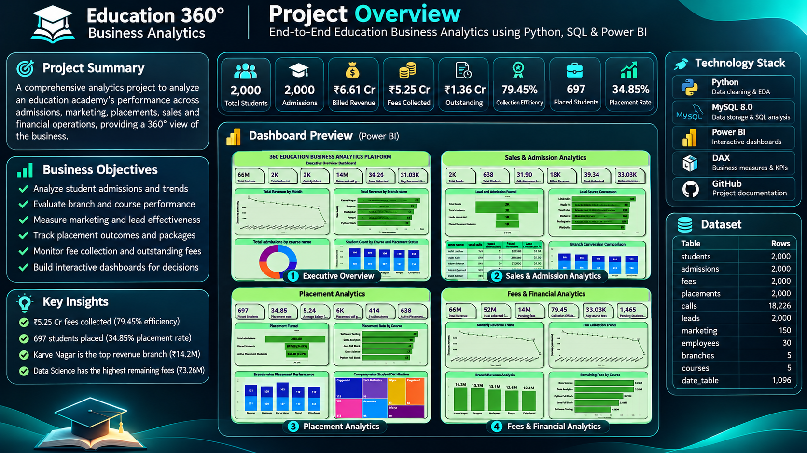
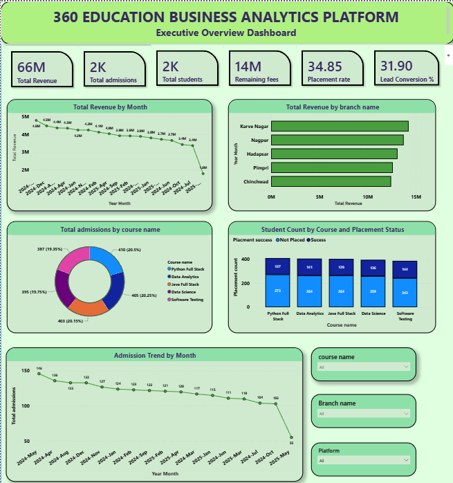
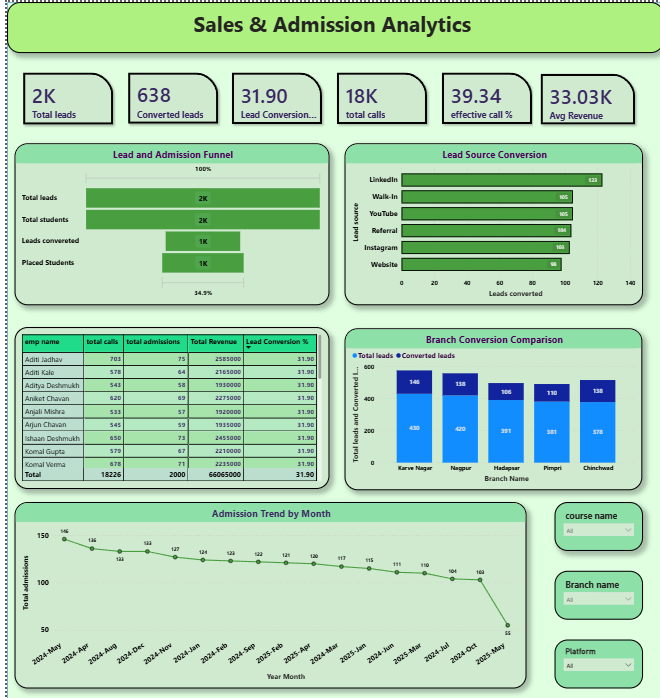
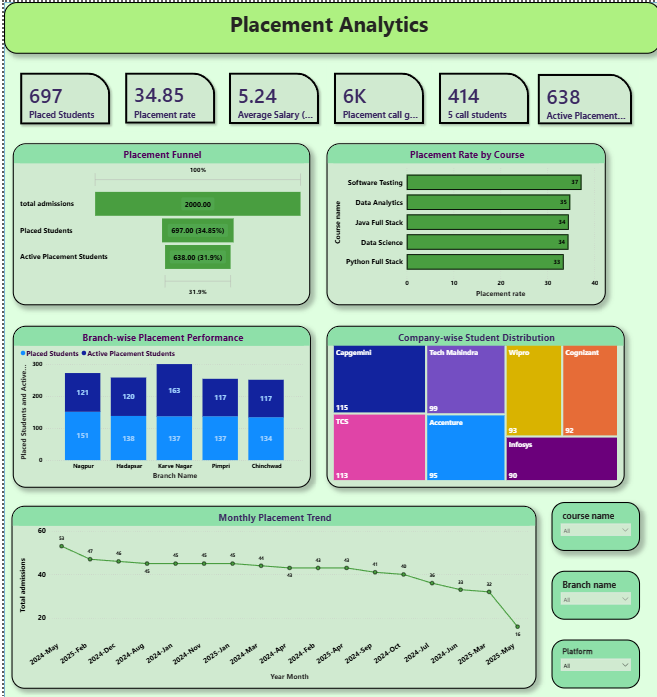
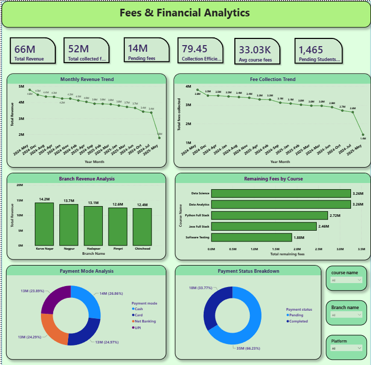

# Aaditya Mahajan | Data Analyst Portfolio

Welcome! This repository showcases my data analytics projects, where I use **Python, SQL, Power BI and DAX** to explore data, answer business questions and communicate insights through dashboards.

## Portfolio at a glance

- **3 projects completed**
- **2 projects planned**
- Core tools: Python, MySQL, Power BI, DAX and GitHub

## Completed projects

### Project 01 — Retail Sales Analytics
<sub>Status: Completed</sub>

Retail sales analysis focused on sales and profit performance, product and category trends, and business insights using SQL and Power BI.

[View Project 01](Project_01_Retail_Sales/)

### Project 02 — Education Analytics
<sub>Status: Completed</sub>

An education analytics project using data analysis and visualization to explore education-related business information.

[View Project 02](Project_02_Education_Analytics/)

### Project 03 — Education 360° Business Analytics
<sub>Status: Completed</sub>

An end-to-end education academy analytics project using **Python, MySQL, Power BI and DAX**. It brings together admissions, marketing campaigns, placements and fee collection.

**Project overview**



**Power BI dashboard pages**

| Executive Overview | Sales & Admission Analytics |
|---|---|
|  |  |

| Placement Analytics | Fees & Financial Analytics |
|---|---|
|  |  |

**Selected KPIs**
- 2,000 students and 2,000 admissions
- ₹6.61 crore total billed revenue
- ₹5.25 crore fees collected
- 79.45% collection efficiency
- 697 placed students
- 34.85% overall recorded placement rate (697 / 2,000 students)

*The placement rate uses all recorded students as its denominator; a separate eligible-student population is not identified in the dataset. Marketing campaign totals are aggregated separately from individual lead records.*

[View Project 03 files and documentation](Project%2003%20%E2%80%94%20Academy%20Business%20Analytics/)

## Planned projects

### Project 04 — HR Analytics & Workforce Intelligence
<sub>Status: Planned</sub>

Planned focus:
- Workforce headcount and employee demographics
- Department and role analysis
- Salary and compensation patterns
- Employee attrition and retention
- HR dashboard with workforce KPIs

**Planned tools:** Python, SQL and Power BI.

### Project 05 — Customer Churn & Retention Analytics
<sub>Status: Planned</sub>

Planned focus:
- Customer behavior and segmentation
- Churn rate and retention analysis
- Customer tenure and usage patterns
- Factors associated with customer churn
- Customer retention dashboard

**Planned tools:** Python, SQL and Power BI.

## Skills and tools

| Area | Tools / techniques |
|---|---|
| Data analysis | Python, Pandas, NumPy |
| SQL | MySQL, joins, CTEs, subqueries, window functions |
| Business intelligence | Power BI, interactive dashboards |
| Metrics | DAX, KPI development |
| Data preparation | Data cleaning, validation, exploratory analysis |
| Reporting | Data visualization, business insights, documentation |
| Version control | Git and GitHub |

## Repository structure

```text
Data_Analyst_Portfolio/
├── Project_01_Retail_Sales/
├── Project_02_Education_Analytics/
├── Project 03 — Academy Business Analytics/
└── README.md
```

## Current roadmap

- [x] Project 01 — Retail Sales Analytics
- [x] Project 02 — Education Analytics
- [x] Project 03 — Education 360° Business Analytics
- [ ] Project 04 — HR Analytics & Workforce Intelligence
- [ ] Project 05 — Customer Churn & Retention Analytics

## Connect

- GitHub: [aaditya747](https://github.com/aaditya747)
- Portfolio: [Data_Analyst_Portfolio](https://github.com/aaditya747/Data_Analyst_Portfolio)

Thanks for visiting my portfolio!
